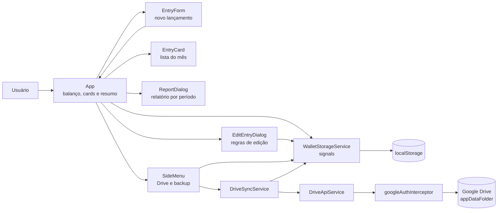
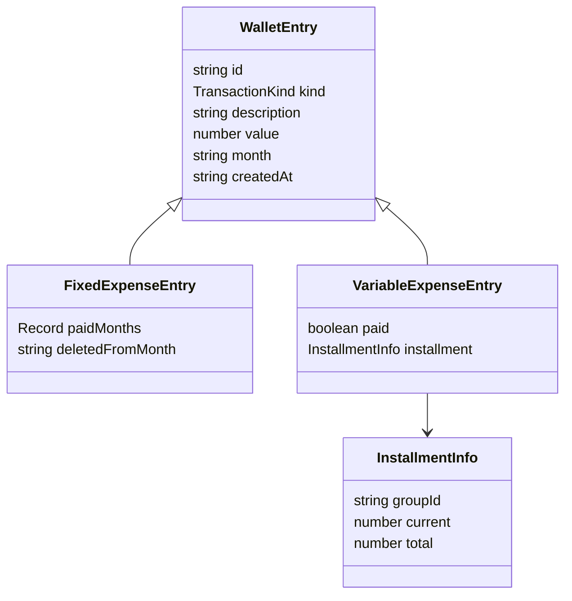
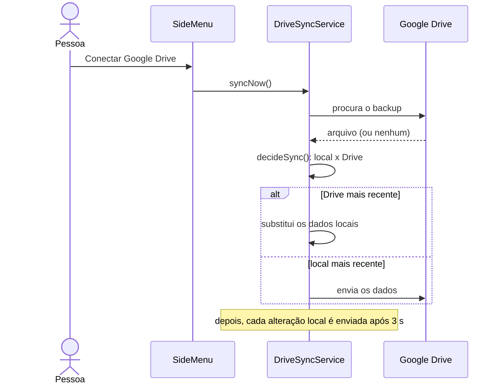

# Sattva Finanças

Aplicativo web gratuito para controle de finanças pessoais: lançamentos por mês, gastos parcelados, cofrinho, relatório por período, backup e sincronização opcional com o Google Drive. Funciona offline (PWA) e os dados ficam com você.


## Utilize o Sattva Finanças

**Acesse:** https://sattva-financas.netlify.app/

**Status:**
[](https://app.netlify.com/projects/sattva-financas/deploys)

**Privacidade:** [Política de Privacidade](https://sattva-financas.netlify.app/privacidade.html)

## Visão geral

O Sattva Finanças é uma aplicação Angular standalone, sem servidor e sem banco de dados. Os lançamentos ficam no `localStorage` do navegador e podem ser levados para outro aparelho de duas formas:

- **Backup manual:** exportar e importar um arquivo JSON.
- **Google Drive (opcional):** login com Google e sincronização automática com um arquivo na pasta oculta do app (`appDataFolder`), usando apenas o escopo `drive.appdata`.

## UX/UI e Design

A experiência de usuário (UX) e a interface (UI) do Sattva Finanças foram desenvolvidas em parceria com **[Jaqueline Lima](https://github.com/jaquelinelima2)**, responsável pela concepção dos fluxos de navegação, identidade visual e protótipos criados no Figma.

O processo de desenvolvimento foi baseado nos protótipos e estudos realizados no Figma, buscando uma experiência simples, intuitiva e focada no uso cotidiano do controle financeiro pessoal.

## Funcionalidades

**Lançamentos**

- Renda mensal, gastos fixos, gastos variáveis e cofrinho, organizados por mês.
- Gastos variáveis parcelados, distribuídos automaticamente nos meses seguintes, mostrando quanto falta pagar.
- Gasto fixo vale do mês em que foi criado em diante; editar ou encerrar vale a partir do mês da tela.
- Edição de parcela recalcula a compra inteira (valor total e quantidade).
- Marcar como pago/não pago e total "falta pagar" no balanço do mês.
- Desfazer exclusão e desfazer importação pelo aviso na tela.

**Relatório**

- Relatório em árvore por período (até 36 meses), com total do período.
- Copiar e imprimir.

**Dados e sincronização**

- Backup em JSON (exportar/importar), com validação dos dados importados.
- Sincronização com o Google Drive: a versão mais recente vence (*last-write-wins*), com envio automático alguns segundos após cada alteração.
- Duas abas abertas não sobrescrevem os dados uma da outra.
- Aviso quando o navegador não consegue salvar (armazenamento cheio ou bloqueado).

**PWA e segurança**

- Instalável, funciona offline (inclusive a fonte, que é servida localmente).
- Aviso de nova versão disponível, sem recarregar sozinho.
- Content-Security-Policy e cabeçalhos de segurança via `public/_headers` (Netlify).

## Stacks

| Camada       | Tecnologia                                                                          |
| ------------ | ----------------------------------------------------------------------------------- |
| Framework    | Angular 21 (standalone, zoneless, OnPush)                                           |
| Linguagem    | TypeScript 5.9                                                                      |
| UI           | Componentes standalone, control flow (`@if`/`@for`), `<dialog>` nativo e CSS puro   |
| Estado       | Angular Signals (`signal`, `computed`, `linkedSignal`, `effect`)                    |
| Formulários  | Reactive Forms tipados + diretiva de máscara monetária (`ControlValueAccessor`)     |
| Persistência | `localStorage` + Google Drive REST v3 (`appDataFolder`)                             |
| Login        | Google Identity Services (token model)                                              |
| HTTP         | `HttpClient` com interceptor funcional para o token do Google                       |
| PWA          | `@angular/service-worker`, `ngsw-config.json` e `manifest.webmanifest`              |
| Fonte        | Poppins via `@fontsource/poppins` (sem Google Fonts)                                |
| Testes       | Angular unit test builder com Vitest                                                |
| Qualidade    | ESLint (`angular-eslint`) e Prettier                                                |
| Hospedagem   | Netlify                                                                             |

## Arquitetura



As regras de negócio ficam em funções puras em `core/utils` (parcelas, edição, visibilidade por mês, resumo, decisão de sincronização, árvore do relatório), o que deixa a maior parte da lógica testável sem Angular.

### Modelo de dados



`WalletEntry` é uma *discriminated union* pelo campo `kind` (`income`, `fixed-expense`, `variable-expense`, `saving`).

### Sincronização com o Drive



## Estrutura

```text
src/
  app/
    app.ts / app.html / app.css   # Tela principal: balanço, cards e resumo
    app.config.ts                 # Locale pt-BR, HttpClient + interceptor, service worker
    core/
      config/                     # Client ID e escopo do Google
      models/                     # Tipos do domínio (WalletEntry, TransactionKind...)
      services/                   # Storage, backup, relatório, Drive, login, toast
      utils/                      # Funções puras com as regras de negócio
    features/
      entry-card/                 # Card com a lista de lançamentos do mês
      entry-form/                 # Formulário de novo lançamento
      edit-entry-dialog/          # Modal de edição
      month-picker/               # Seletor de mês
      report-dialog/              # Relatório por período
      side-menu/                  # Menu lateral (Drive, backup, ferramentas)
    shared/
      components/                 # Modal (<dialog>) e avisos (toast)
      directives/                 # Máscara de moeda
      forms/                      # Validadores compartilhados
public/
  _headers                        # CSP e cabeçalhos de segurança (Netlify)
  privacidade.html                # Política de Privacidade
  manifest.webmanifest            # Configuração PWA
  icons/                          # Ícones do PWA
scripts/
  generate-icons.js               # Geração dos ícones via sharp
```

## Desenvolvimento

```bash
npm install          # o .npmrc já configura legacy-peer-deps
npm start            # http://localhost:4200
npm test             # testes (Vitest)
npm run lint         # ESLint
npm run build        # build de produção em dist/
```

Para testar o PWA (service worker), sirva a build de produção por HTTP; o `ng serve` não ativa o service worker.

## Backup e dados

Os lançamentos ficam na chave `sattva-wallet-entries-v1` do `localStorage`, e a data da última alteração em `sattva-wallet-modified-at` (usada para comparar com o backup do Drive).

O backup exporta um JSON com metadados (`app`, `version`, `exportedAt`) e a lista de lançamentos. Na importação, cada item é validado (mês, valor, descrição, ids repetidos) e os dados atuais são substituídos, com opção de desfazer.

O serviço também migra dados antigos das chaves `rendas`, `gastosFixos` e `gastosVariaveis` para o formato atual.
